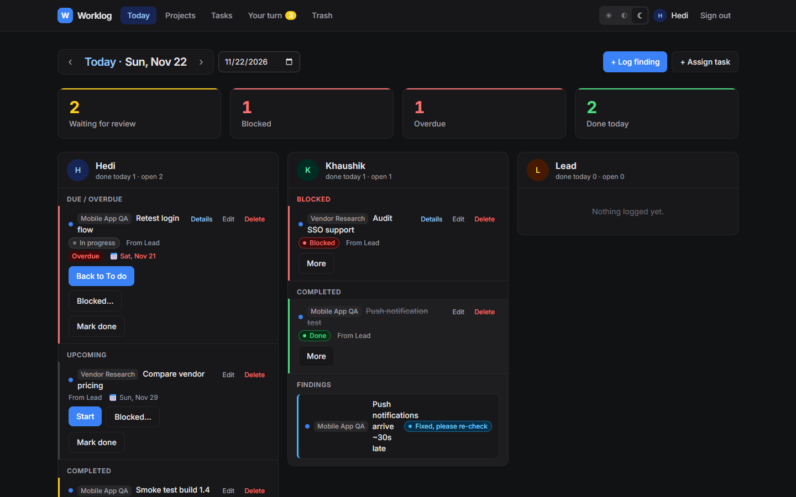
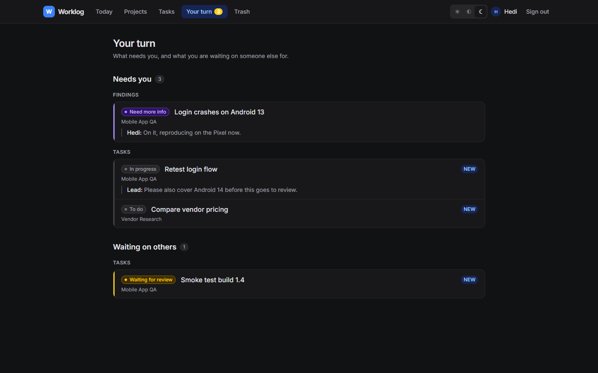
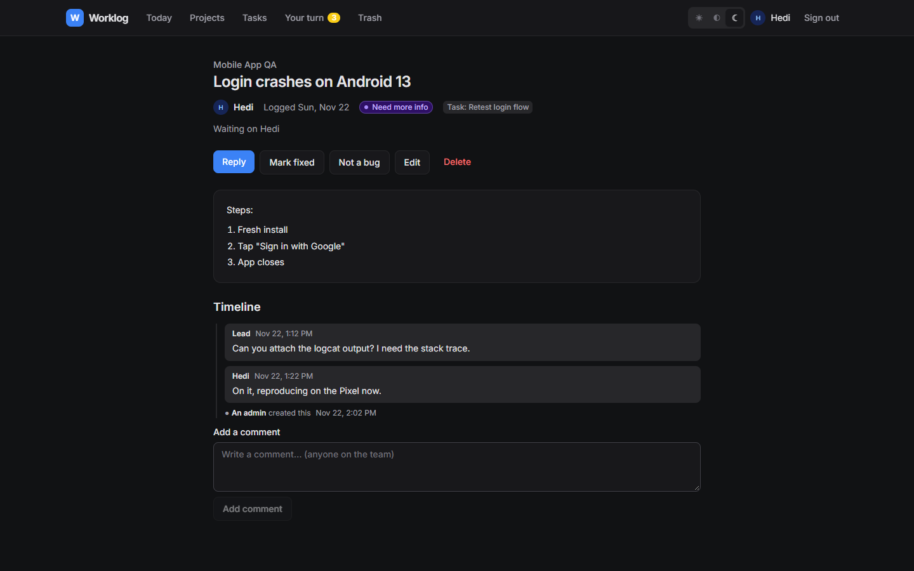
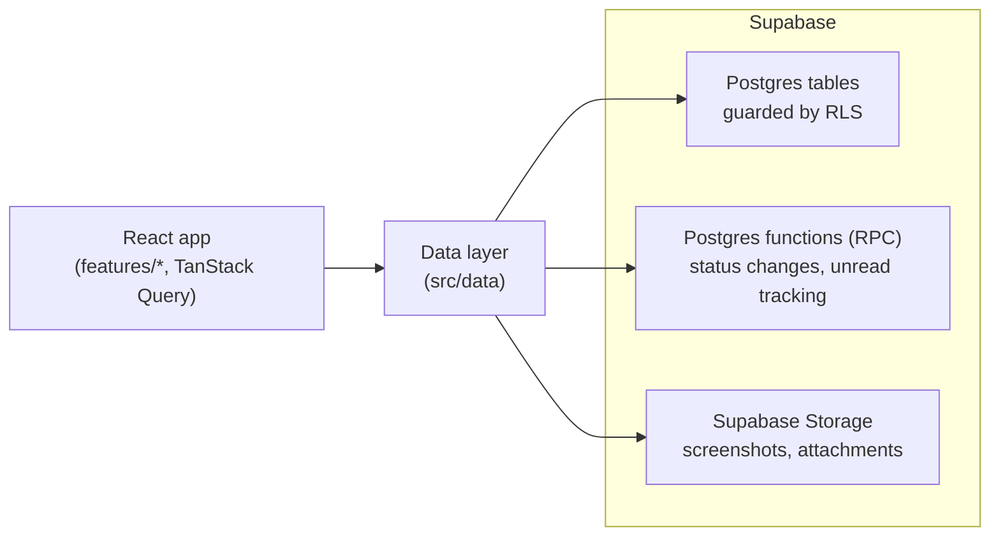

# Worklog

A small team's daily work tracker, built to replace a Google Sheet that had grown too long to use.

Each bug, test result or research note becomes its own entry, with screenshots, filed under a project and a day. Open the app in the morning and you see what each person did, what is waiting on whom, and what is stuck.

## Who uses it

The TTU Online dev team (3 people) uses it every day. It's an internal tool, so there's no public demo link: see the screenshots below, or run it locally with demo data.

## What it does

- **Today view**: one column per person, showing that day's tasks and findings.
- **Findings** follow a bug lifecycle: open → fixed → verified. Someone other than the fixer has to confirm the fix.
- **Tasks** can have checklists, deadlines, file attachments (PDF and DOCX preview right in the page), and an optional review step.
- **"Your turn" inbox**: every item belongs to exactly one person at a time, and that person sees it here.
- **Full history**: every change shows up in a timeline with who made it and when. Deleted items go to a trash and can be restored.
- **Comments** on every finding and task, written in Markdown.

## Screenshots

Demo data from `npm run seed:demo`.

**Today**: one column per person, with counters for what's blocked, overdue or waiting for review.


**Your turn**: what needs you, and what you're waiting on.


**A finding** with its status, actions and full timeline.


## Engineering highlights

- **Security in the database, not just the UI.** Supabase row level security (RLS) and Postgres functions enforce the rules, such as "you can't approve your own work". Rules can't be skipped by calling the API directly. Public sign-ups are off in production; accounts are created by an admin.
- **Tested at every layer.** Database rules have their own pgTAP tests. Unit tests (Vitest + Testing Library) cover the logic and UI. Integration tests run against a real local Supabase.
- **Designed before built.** Each feature started as a short written spec and plan, and a UX audit tracks what still needs fixing.
- **Changed based on real use.** The app started with a lead/member permission model. In practice it got in the way, so it was replaced with a flat model (everyone can edit, every change is logged), with migrations that moved the existing data over.
- **Runs for $0.** Free tiers only: Vercel hosts the frontend, Supabase provides the database, login and file storage.

## Architecture



Components never call Supabase directly. They go through `src/data`, and the database makes the final call on who can do what.

## How I used AI

I used Claude Code to draft code, tests and feature specs; I reviewed every diff myself, and wrote or checked the RLS policies and pgTAP tests line by line, since those are the security boundary.

## Tech stack

React 19 · TypeScript · Vite · Tailwind CSS · TanStack Query · React Router · Supabase (Postgres, Auth, Storage) · Vitest · pgTAP · Vercel

## Run it locally

Needs Node and Docker (for local Supabase).

```bash
npm install
npx supabase start      # local Postgres + auth + storage
npm run env:local       # writes .env.local and .env.test from the local Supabase keys
npm run test:integration && npm run seed:demo   # optional: test accounts + demo data
npm run dev
```

Tests:

```bash
npm test                # unit tests
npm run db:test         # database tests (pgTAP)
npm run test:integration
```
